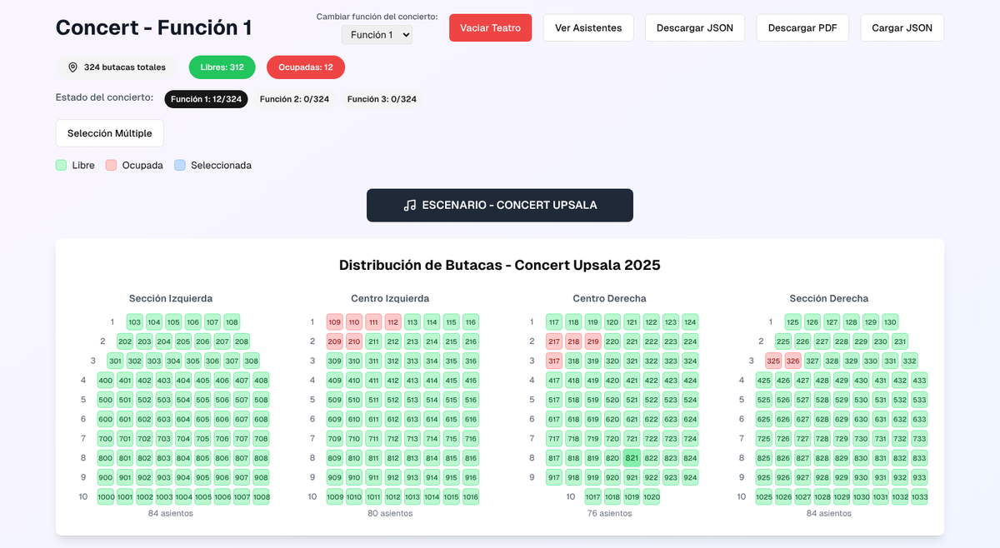

# 🎵 Concert Upsala 2025 - Sistema de Gestión de Butacas

> **English summary.** Seat-assignment and guest-management web app built for Colegio Upsala's 2025 annual concert: three independent shows with 324 seats each, single, multi-seat and bulk assignment, search, PDF guest lists, JSON import/export and automatic local persistence. Built with Next.js 15, React 19, TypeScript, Tailwind CSS and shadcn/ui.

<p align="center"></p>

Sistema web desarrollado para el **Colegio Upsala** para gestionar las invitaciones y asignación de asientos del **Concert Anual 2025**. Permite administrar **3 funciones independientes** con **324 butacas cada una**.


## 🌟 Características Principales

### 🎭 Gestión Multi-Función

- **3 funciones independientes** (Función 1, 2 y 3)
- **324 asientos por función** distribuidos en 4 secciones
- Cambio dinámico entre funciones
- Estado visual del ocupado/libre para cada función

### 🪑 Distribución del Teatro

```
📍 Layout del Teatro (324 asientos):
┌─────────────────────────────────────────────────────────┐
│                    🎭 ESCENARIO                          │
├─────────────┬─────────────┬─────────────┬─────────────┤
│  Sección    │   Centro    │   Centro    │  Sección    │
│ Izquierda   │ Izquierda   │  Derecha    │  Derecha    │
│ 84 asientos │ 80 asientos │ 76 asientos │ 84 asientos │
│  10 filas   │  10 filas   │  10 filas   │  10 filas   │
└─────────────┴─────────────┴─────────────┴─────────────┘
```

### 🎯 Funcionalidades de Asignación

- **Selección individual** de butacas
- **Selección múltiple** para grupos familiares
- **Asignación masiva** a un mismo invitado
- **Edición y liberación** de asientos asignados
- **Notas adicionales** para cada invitado

### 📊 Gestión de Datos

- **Persistencia automática** en localStorage
- **Exportación/Importación JSON** unificada
- **Generación de PDF** con listados de invitados
- **Búsqueda avanzada** por nombre o número de butaca
- **Protección contra pérdida de datos** (alerta beforeunload)

### 🔍 Sistema de Búsqueda y Listados

- **Listado completo** de invitados por función
- **Búsqueda en tiempo real** por nombre o butaca
- **Agrupación por invitado** con todas sus butacas
- **Vista de secciones** y distribución por áreas

## 🚀 Instalación y Configuración

### Requisitos Previos

- Node.js 18+
- pnpm (recomendado) o npm
- Navegador web moderno

### Instalación

```bash
# Clonar el repositorio
git clone <url-del-repositorio>
cd teatro-butacas

# Instalar dependencias
pnpm install

# Ejecutar en modo desarrollo
pnpm dev

# Abrir en el navegador
# http://localhost:3000
```

### Estructura del Proyecto

```
teatro-butacas/
├── app/
│   ├── page.tsx              # Componente principal
│   ├── layout.tsx            # Layout de la aplicación
│   ├── globals.css           # Estilos globales
│   └── lib/
│       ├── butaca.types.ts   # Tipos TypeScript
│       ├── pdf-utils.ts      # Utilidades para PDF
│       └── jsPDF.min.js      # Librería PDF
├── components/
│   ├── ui/                   # Componentes shadcn/ui
│   └── theme-provider.tsx    # Proveedor de tema
├── public/                   # Archivos estáticos
├── package.json
├── tailwind.config.ts
└── README.md
```

## 🎮 Guía de Uso

### 1️⃣ Inicialización

1. Al abrir la aplicación, hacer clic en **"Inicializar Concert Upsala 2025"**
2. Esto creará las 3 funciones con 324 butacas vacías cada una

### 2️⃣ Navegación entre Funciones

- Usar el **selector desplegable** en la parte superior
- El estado de cada función se mantiene independientemente
- Los indicadores muestran ocupadas/total por función

### 3️⃣ Asignación de Butacas

#### Asignación Individual

1. Hacer clic en una butaca **verde** (libre)
2. Completar el **nombre del invitado**
3. Agregar **notas opcionales** (grado, relación, contacto)
4. Confirmar la asignación

#### Asignación Múltiple

1. Activar **"Selección Múltiple"**
2. Hacer clic en las butacas deseadas (se marcan en **azul**)
3. Hacer clic en **"Asignar Grupo"**
4. Completar los datos del invitado
5. Todas las butacas se asignan al mismo nombre

### 4️⃣ Gestión de Invitados

- **Ver Asistentes**: Lista completa con búsqueda
- **Editar**: Clic en butaca roja para modificar datos
- **Liberar**: Eliminar asignación individual o grupal
- **Buscar**: Por nombre completo o número de butaca

### 5️⃣ Exportación e Importación

#### Descargar Datos

- **Descargar JSON**: Exporta las 3 funciones en un archivo unificado
- **Descargar PDF**: Genera reporte con listado de invitados
- Archivo: `concert_upsala_2025.json`

#### Cargar Datos

- **Cargar JSON**: Importa datos previamente exportados
- Compatible con formato unificado (3 funciones) y legacy (función actual)
- Restaura completamente el estado de las asignaciones

## 🛡️ Protección de Datos

### Persistencia Automática

- **localStorage**: Guarda automáticamente cada cambio
- **Recuperación**: Restaura el estado al recargar la página
- **Independiente**: Cada función mantiene su propio storage

### Prevención de Pérdida

- **Alerta beforeunload**: Avisa antes de cerrar/navegar si hay datos
- **Mensaje personalizado**: Recomienda descargar JSON antes de salir
- **Solo cuando necesario**: Solo alerta si hay butacas asignadas

## 🎨 Tecnologías Utilizadas

### Frontend

- **Next.js 15.2.4** - Framework React con SSR
- **React 19** - Librería de componentes
- **TypeScript** - Tipado estático
- **Tailwind CSS** - Framework de estilos
- **shadcn/ui** - Componentes de interfaz

### Librerías Específicas

- **jsPDF + jspdf-autotable** - Generación de PDF
- **Lucide React** - Iconografía
- **Class Variance Authority** - Gestión de clases CSS

### Características Técnicas

- **Responsive Design** - Adaptable a dispositivos móviles
- **Accesibilidad** - Cumple estándares WCAG
- **Performance** - Optimizado con Next.js
- **TypeScript** - Código tipado y mantenible

## 📋 Estados de las Butacas

| Color    | Estado       | Descripción                          |
| -------- | ------------ | ------------------------------------ |
| 🟢 Verde | Libre        | Butaca disponible para asignar       |
| 🔴 Rojo  | Ocupada      | Butaca asignada a un invitado        |
| 🔵 Azul  | Seleccionada | Butaca seleccionada en modo múltiple |

## 🎭 Contexto de Uso

### Colegio Upsala - Concert 2025

- **Evento**: Concierto anual del colegio
- **Capacidad**: 324 invitados por función
- **Funciones**: 3 presentaciones independientes
- **Público**: Familias, estudiantes, docentes, comunidad educativa

### Casos de Uso Típicos

1. **Secretaría**: Asignar butacas según lista de invitados
2. **Dirección**: Revisar distribución y ocupación
3. **Coordinación**: Generar listados para el día del evento
4. **Familias**: Ubicar asientos asignados (futura funcionalidad)

## 🚨 Funciones de Seguridad

### Validaciones

- **Nombres obligatorios**: No permite asignaciones sin nombre
- **Prevención de sobreescritura**: Confirma antes de modificar
- **Butacas únicas**: Evita asignaciones duplicadas
- **Datos consistentes**: Validación de tipos TypeScript

### Recuperación de Errores

- **Fallback de localStorage**: Si hay error, inicializa vacío
- **Importación robusta**: Detecta formato de archivo automáticamente
- **Estados de error**: Manejo graceful de excepciones

## 🤝 Desarrollado Por

**Tomás Lonati** - Desarrollador Full Stack

- Sistema especializado para el **Colegio Upsala**
- Desarrollo personalizado para **Concert 2025**
- Enfoque en usabilidad y confiabilidad

---

### 📞 Soporte y Contacto

Para soporte técnico o consultas sobre el sistema, contactar con el desarrollador.

### 🎓 Colegio Upsala

Sistema desarrollado exclusivamente para la gestión de invitaciones del Concert Anual 2025.

---

**¡Que el Concert Upsala 2025 sea un éxito! 🎭🎵**
